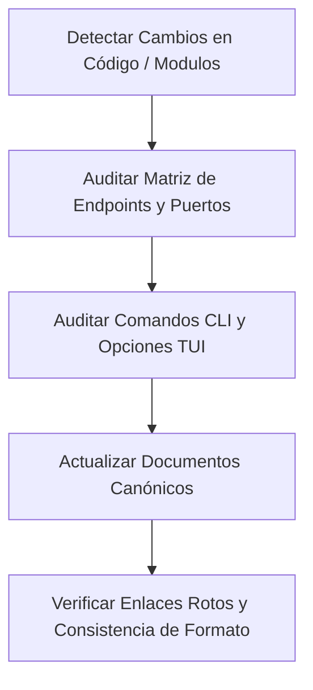

# Doc Sync Skill (`doc-sync`)

Habilidad especializada para auditar y mantener sincronizada la documentación técnica del clúster Kind con el código real y las capacidades desplegadas.

---

## 🎯 Propósito y Casos de Uso

Activa esta skill siempre que:
1. Se añada, modifique o elimine un módulo en `cli/src/modules/`.
2. Se introduzca un nuevo subcomando en la CLI de Node.js (`cli/bin/kind-manager.js` o `cli/src/menu.js`).
3. Se agregue un nuevo servicio, Ingress, template YAML o contenedor de soporte.
4. Se complete un Plan SDD (`docs/plans/PLAN-XXXX-*.md`) y deba reflejarse en los manuales de usuario y tablas de endpoints.
5. El usuario solicite explícitamente revisar, reorganizar o actualizar la documentación del repositorio.

---

## 📋 Protocolo de Ejecución (Flujo de Sincronización)

Al ejecutarse, sigue rigurosamente los siguientes 5 pasos:

### Paso 1: Detección de Cambios en Código y Manifiestos
Inspecciona:
- Módulos en `cli/src/modules/` para identificar nuevas funciones exportadas o parámetros.
- Manifiestos en `templates/` e `ingress/` para verificar nuevos namespaces, puertos o hostnames.
- `package.json` y `Makefile` para verificar nuevos scripts de compilación o ejecución.

### Paso 2: Auditoría de Endpoints y Puertos
Compara los servicios activos contra:
- **`README.md`**: Tabla `Local Endpoints & Access`.
- **`docs/ARCHITECTURE.md`**: Sección `Detalle de Piezas y Función en el Stack` y tabla `Matriz de Conectividad y Redes`.
- **`AGENTS.md`**: Tabla `Architectural Components & Ingress Routing`.
- Asegura que cualquier nuevo dominio `.local` esté incorporado en la lista predeterminada de `cli/src/modules/dns.js` y documentado en `docs/DNS-GUIDE.md`.

### Paso 3: Auditoría de Comandos CLI
Verifica que todo comando añadido al switch `runCliCommand()` en `cli/src/menu.js`:
1. Esté documentado en la función `showHelp()` de `cli/src/menu.js`.
2. Esté listado en la sección `Non-Interactive CLI / CI/CD Automation` de `README.md`.
3. Esté reflejado en la sección `Execution Protocols & Commands` de `AGENTS.md`.

### Paso 4: Actualización de Guías Canónicas y Planes
1. Si un plan en `docs/plans/` fue ejecutado, actualiza su estado a `Completado` y marca las tareas atómicas `[x]`.
2. Si hubo cambios arquitectónicos o decisiones estructurales, verifica que exista el correspondiente ADR en `docs/decisions/`.
3. Actualiza el índice maestro `docs/README.md` para enlazar los nuevos documentos o guías.

### Paso 5: Verificación de Integridad
- Asegura que todos los enlaces relativos en Markdown sean válidos y apunten a rutas existentes.
- Verifica que las tablas de puertos no contengan discrepancias (p.ej. MongoDB en `37017` vs `27017`).
- Ejecuta `npm test` para garantizar que los tests unitarios de CLI/módulos sigan pasando.
