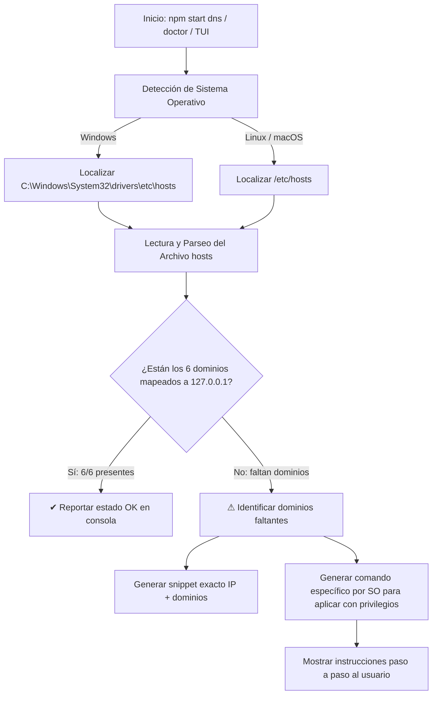

# Manual del Asistente DNS Local (`dns.js`)

Este documento describe en profundidad el funcionamiento del subsistema de DNS local, su arquitectura multiplataforma, los motivos de su diseño y cómo utilizarlo para que los dominios `.local` resuelvan limpiamente en el clúster Kind.

---

## 1. Contexto y Problema

En un entorno local basado en Kind, el Ingress Controller (Traefik) expone los puertos `80` (HTTP) y `443` (HTTPS) mapeados directamente al host (`127.0.0.1`). 

Para acceder a las diferentes herramientas mediante dominios limpios y legibles (`dashboard.local`, `argocd.local`, `kafka-ui.local`, etc.), el navegador web o cliente HTTP necesita traducir esos dominios a la dirección IP de loopback (`127.0.0.1`). Dado que los dominios con sufijo `.local` no existen en los servidores DNS públicos de internet, el sistema operativo del host debe resolverlos mediante su archivo local `hosts`.

Sin una herramienta automatizada, los desarrolladores se enfrentaban a:
1. Errores `ERR_NAME_NOT_RESOLVED` o páginas no encontradas tras levantar el stack.
2. La necesidad de buscar y recordar la ruta exacta del archivo `hosts` en cada sistema operativo.
3. La manipulación manual propensa a errores de formato y sintaxis.

---

## 2. Cómo Funciona el Asistente DNS

El módulo está implementado en [`cli/src/modules/dns.js`](../cli/src/modules/dns.js) y validado por la suite de pruebas [`cli/tests/dns.test.js`](../cli/tests/dns.test.js).

### 2.1 Flujo de Ejecución



### 2.2 Dominios Requeridos por el Stack

El asistente valida de manera predeterminada los siguientes 6 dominios:
- `dashboard.local` (Hub de bienvenida y accesos rápidos)
- `headlamp.local` (Consola visual de recursos Kubernetes)
- `registry.local` (Interfaz web de Zot OCI Registry & escaneo Trivy)
- `argocd.local` (Consola GitOps de ArgoCD)
- `kafka-ui.local` (Consola de administración de Strimzi Kafka)
- `apisix.local` (Puerta de enlace Apache APISIX)

### 2.3 Tolerancia a Fallos y Parseo Robusto

La función `parseHostsFile()` aplica las siguientes reglas de higiene:
- **Ignora comentarios**: Las líneas que inician con `#` o comentarios en línea son descartados.
- **Ignora mayúsculas/minúsculas**: Normaliza todos los nombres a minúsculas (`toLowerCase()`).
- **Verifica asociación estricta a loopback**: Solo considera válidos aquellos dominios que apunten explícitamente a `127.0.0.1` o `127.0.1.1`.
- **Manejo de permisos**: Si el archivo de hosts tiene restricciones de lectura no elevadas, el módulo no aborta abruptamente; reporta la advertencia y sugiere el comando correspondiente.

---

## 3. Modos de Uso

### Modo 1: Subcomando Directo CLI
Puedes verificar el estado en cualquier momento ejecutando:

```bash
npm start dns
# O también:
node ./cli/bin/kind-manager.js dns
```

**Salida de ejemplo (cuando todo está correcto):**
```text
Verificando configuración de DNS local en el archivo hosts...
Archivo inspeccionado: C:\WINDOWS\System32\drivers\etc\hosts
✔ Dominios correctamente asociados a 127.0.0.1 (6/6):
  - dashboard.local
  - headlamp.local
  - registry.local
  - argocd.local
  - kafka-ui.local
  - apisix.local

✔ Todos los dominios .local están correctamente configurados en tu archivo hosts.
```

### Modo 2: Menú Interactivo TUI
Al ejecutar `npm start` (o `make cli`), selecciona la opción:
```text
🌐 DNS Assistant & Hosts Check  (Verifica y asiste en la configuración de dominios .local)
```
Se presentará una tarjeta visual detallando el archivo inspeccionado, los dominios configurados y los faltantes.

### Modo 3: Diagnóstico Global (`npm start doctor`)
El comando `doctor` comprueba automáticamente los requisitos del sistema (Docker, Kind, Helm, Kubectl), el estado del cluster Kind, los pods y ahora también la **resolución de DNS local**, alertando si el desarrollador no podrá acceder a las URLs por Ingress.

---

## 4. Instrucciones de Sincronización Manual o Asistida

Si el asistente detecta que faltan dominios, proporcionará el comando exacto que debes ejecutar con permisos elevados:

### En Windows (PowerShell como Administrador):
```powershell
Add-Content -Path "C:\Windows\System32\drivers\etc\hosts" -Value "127.0.0.1 dashboard.local headlamp.local registry.local argocd.local kafka-ui.local apisix.local"
```

### En Linux / macOS (Terminal):
```bash
echo "127.0.0.1 dashboard.local headlamp.local registry.local argocd.local kafka-ui.local apisix.local" | sudo tee -a /etc/hosts
```
