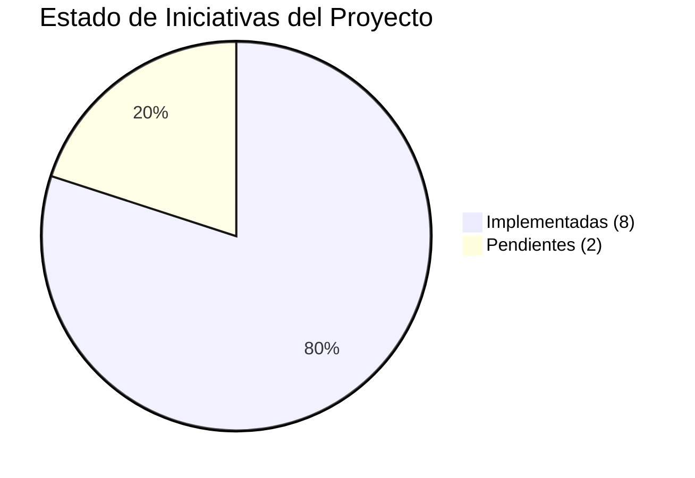

# 📊 Panel de Control y Estado de Iniciativas (Backlog SDD)

Este panel muestra de forma visual y resumida el estado de cada iniciativa de la plataforma, discriminando entre lo que ya está **implementado y validado** frente a lo que se encuentra **pendiente en el backlog**.

---

## 📈 Resumen Ejecutivo del Backlog

```
Total de Iniciativas Planificadas: 10
  🟢 Implementadas y Validadas:   8  (80%)
  🟡 En Progreso / Roadmap:        0  (0%)
  🔴 Pendientes en Backlog:        2  (20%)
```



---

## 🚦 Tablero de Estado por Iniciativa

| ID | Iniciativa / Capacidad | Especificación | Plan Atómico | Estado Actual | Talla | Evidencia / Endpoint |
| :---: | :--- | :--- | :--- | :---: | :---: | :--- |
| **01** | **Kafka KRaft Mode** (Sin ZooKeeper) | [`SPEC-0001`](specs/SPEC-0001-kafka-kraft-migration.md) | [`PLAN-0001`](plans/PLAN-0001-kafka-kraft-migration.md) | `🟢 COMPLETADO` | **M** | Strimzi Operator + `kafka-cluster` en KRaft mode. |
| **02** | **Traefik Ingress + APISIX Gateway** | [`SPEC-0002`](specs/SPEC-0002-traefik-apisix-migration.md) | [`PLAN-0002`](plans/PLAN-0002-traefik-apisix-migration.md) | `🟢 COMPLETADO` | **L** | `http://apisix.local` + `hostPort: 80/443`. |
| **03** | **Zot OCI Registry con Trivy** | *(Plataforma)* | [`PLAN-0003`](plans/PLAN-0003-versions-security-and-deployment.md) | `🟢 COMPLETADO` | **S** | `http://registry.local` / `localhost:5000`. |
| **04** | **Observabilidad (Headlamp + Metrics)** | [`SPEC-0003`](specs/SPEC-0003-observability-headlamp-metrics-server.md) | [`PLAN-0004`](plans/PLAN-0004-observability-headlamp-metrics-server.md) | `🟢 COMPLETADO` | **M** | `http://headlamp.local` + Metrics-Server activo. |
| **05** | **CLI Interactiva en Node.js (TUI)** | [`SPEC-0004`](specs/SPEC-0004-interactive-node-cli.md) | [`PLAN-0005`](plans/PLAN-0005-interactive-node-cli.md) | `🟢 COMPLETADO` | **M** | `npm start` (TUI interactiva y flags CLI). |
| **06** | **Asistente DNS Local (`*.local`)** | [`SPEC-0005`](specs/SPEC-0005-advanced-platform-roadmap.md) | [`PLAN-0006`](plans/PLAN-0006-dns-assistant.md) | `🟢 COMPLETADO` | **S** | `npm start dns` / chequeo dinámico de hosts. |
| **07** | **Cert-Manager & TLS Local HTTPS** | [`SPEC-0005`](specs/SPEC-0005-advanced-platform-roadmap.md) | [`PLAN-0007`](plans/PLAN-0007-cert-manager-local-tls.md) | `🔴 PENDIENTE` | **M** | *En backlog: ClusterIssuer CA autofirmada.* |
| **08** | **Storage Persistente para Kafka/Mongo** | [`SPEC-0005`](specs/SPEC-0005-advanced-platform-roadmap.md) | [`PLAN-0008`](plans/PLAN-0008-persistent-storage.md) | `🔴 PENDIENTE` | **M** | *En backlog: PVCs con StorageClass Kind.* |
| **09** | **Microservicio Demo E2E (`order-service`)** | [`SPEC-0005`](specs/SPEC-0005-advanced-platform-roadmap.md) | [`PLAN-0009`](plans/PLAN-0009-demo-microservice-e2e.md) | `🟢 COMPLETADO` | **M** | `http://orders.local` (Express + Kafka + Mongo). |
| **10** | **Developer Hub & Dashboard v2.0** | [`SPEC-0003`](specs/SPEC-0003-observability-headlamp-metrics-server.md) | [`PLAN-0010`](plans/PLAN-0010-operational-service-hub-dashboard.md) | `🟢 COMPLETADO` | **M** | `http://dashboard.local` (telemetría + visor logs). |

---

## 🎯 Próximas Tareas Prioritarias en Backlog

1. **[PLAN-0007: Cert-Manager y TLS Local HTTPS](plans/PLAN-0007-cert-manager-local-tls.md)**
   - Desplegar `cert-manager` vía Helm.
   - Configurar CA autofirmada de desarrollo para emitir certificados HTTPS válidos a `*.local`.
   - Habilitar TLS en Ingress de Traefik para tráfico seguro sin advertencias críticas.

2. **[PLAN-0008: Almacenamiento Persistente para Kafka y MongoDB](plans/PLAN-0008-persistent-storage.md)**
   - Incorporar opción configurable (`--persistent`) para montar PersistentVolumeClaims en Kind.
   - Preservar tópicos de Kafka y colecciones de MongoDB entre reinicios de contenedores/pods.

---

## 🛠️ Cómo Consultar o Actualizar este Panel

- **Para consultar la guía metodológica:** Revisa [`docs/SDD-GUIDE.md`](SDD-GUIDE.md).
- **Para ejecutar una sincronización automática de documentación:** Ejecuta el skill de Antigravity:
  ```bash
  .agent/skills/doc-sync/
  ```
