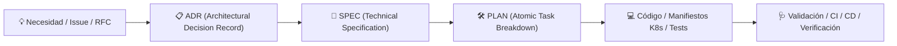

# Guía del Ciclo de Vida SDD (Spec-Driven Development) & Arquitectura de Almacenamiento

Esta guía describe el marco de trabajo **SDD (Spec-Driven Development)** adoptado en `kind-cluster-deployment`, la forma canónica de almacenar especificaciones, planes y decisiones, y cómo se gestiona la trazabilidad del backlog.

---

## 1. ¿Qué es SDD y por qué lo usamos?

El desarrollo guiado por especificaciones (**Spec-Driven Development**) establece que ninguna funcionalidad, refactor o infraestructura no trivial se codifica directamente sin antes acordar:

1. **La Decisión de Arquitectura (ADR):** El *por qué*, las alternativas analizadas y los trade-offs asumidos.
2. **La Especificación Técnica (SPEC):** El *qué*, definiendo contratos de API, criterios de aceptación (Given/When/Then), requerimientos no funcionales (NFRs) y límites claros de alcance (IN/OUT).
3. **El Plan de Implementación (PLAN):** El *cómo*, descomponiendo la especificación en tareas atómicas y verificables con validación de regresión.



---

## 2. Convenciones de Almacenamiento en el Repositorio

La documentación arquitectónica vive bajo el directorio `docs/` con prefijos estandarizados de cuatro dígitos numéricos para garantizar orden cronológico y trazabilidad bi-direccional:

```
docs/
├── decisions/             # Architecture Decision Records
│   └── ADR-{NNNN}-{slug}.md
├── specs/                 # Technical Specifications
│   └── SPEC-{NNNN}-{slug}.md
└── plans/                 # Implementation Plans & Task Backlog
    └── PLAN-{NNNN}-{slug}.md
```

### Reglas de Nomenclatura y Enlace:
- **`NNNN`**: Identificador secuencial (p. ej. `0001`, `0002`, `0010`).
- **`slug`**: Descripción concisa en kebab-case.
- **Trazabilidad cruzada (MANDATORIA):**
  - Cada `PLAN-XXXX` debe enlazar a su `SPEC-XXXX` y `ADR-XXXX` de origen en su cabecera.
  - Cada `SPEC-XXXX` debe listar los `PLAN-XXXX` asociados para auditar el grado de cobertura y completitud.

---

## 3. Estados del Ciclo de Vida

### Estados de una SPEC:
- `clarify` (o `Abierta`): En discusión, con preguntas abiertas o requerimientos pendientes de confirmar.
- `closed` (o `Cerrada`): Contrato formalizado sin ambigüedades, lista para planificación.
- `implemented` (o `Implementada`): Todas las tareas y planes derivados han sido entregados y verificados.

### Estados de un PLAN:
- `Pendiente / Programado`: Aprobado para ejecución en el backlog, pero aún no iniciado.
- `En Progreso`: Tareas en desarrollo activo.
- `Implementado / Completado`: Todas las tareas atómicas finalizadas, código desplegable y tests pasando.

---

## 4. Matriz de Cobertura y Trazabilidad

| ID | Iniciativa / Componente | ADR Asociado | SPEC Asociada | Plan de Tareas | Estado de Entrega |
| :---: | :--- | :--- | :--- | :--- | :---: |
| **01** | Migración Kafka KRaft (sin ZooKeeper) | [ADR-0001](decisions/ADR-0001-kafka-kraft-mode.md) | [SPEC-0001](specs/SPEC-0001-kafka-kraft-migration.md) | [PLAN-0001](plans/PLAN-0001-kafka-kraft-migration.md) | `COMPLETADO` |
| **02** | Traefik Ingress & APISIX Gateway | [ADR-0002](decisions/ADR-0002-traefik-ingress-and-apisix-gateway.md) | [SPEC-0002](specs/SPEC-0002-traefik-apisix-migration.md) | [PLAN-0002](plans/PLAN-0002-traefik-apisix-migration.md) | `COMPLETADO` |
| **03** | Versiones Estables & Zot Registry | [ADR-0003](decisions/ADR-0003-stable-versions-upgrade-and-kafbat-ui.md) / [ADR-0005](decisions/ADR-0005-zot-registry-with-trivy.md) | N/A (Plataforma) | [PLAN-0003](plans/PLAN-0003-versions-security-and-deployment.md) | `COMPLETADO` |
| **04** | Headlamp & Metrics-Server | [ADR-0004](decisions/ADR-0004-headlamp-and-metrics-server.md) | [SPEC-0003](specs/SPEC-0003-observability-headlamp-metrics-server.md) | [PLAN-0004](plans/PLAN-0004-observability-headlamp-metrics-server.md) | `COMPLETADO` |
| **05** | Orquestador TUI Autónomo Node.js | [ADR-0006](decisions/ADR-0006-interactive-node-cli.md) | [SPEC-0004](specs/SPEC-0004-interactive-node-cli.md) | [PLAN-0005](plans/PLAN-0005-interactive-node-cli.md) | `COMPLETADO` |
| **06** | Asistente y Sincronizador DNS Local | [ADR-0007](decisions/ADR-0007-advanced-platform-roadmap.md) | [SPEC-0005](specs/SPEC-0005-advanced-platform-roadmap.md) | [PLAN-0006](plans/PLAN-0006-dns-assistant.md) | `COMPLETADO` |
| **07** | Cert-Manager y TLS Local HTTPS | [ADR-0007](decisions/ADR-0007-advanced-platform-roadmap.md) | [SPEC-0005](specs/SPEC-0005-advanced-platform-roadmap.md) | [PLAN-0007](plans/PLAN-0007-cert-manager-local-tls.md) | `PENDIENTE` |
| **08** | Almacenamiento Persistente PVC | [ADR-0007](decisions/ADR-0007-advanced-platform-roadmap.md) | [SPEC-0005](specs/SPEC-0005-advanced-platform-roadmap.md) | [PLAN-0008](plans/PLAN-0008-persistent-storage.md) | `PENDIENTE` |
| **09** | Microservicio Demo E2E (`order-service`) | [ADR-0007](decisions/ADR-0007-advanced-platform-roadmap.md) | [SPEC-0005](specs/SPEC-0005-advanced-platform-roadmap.md) | [PLAN-0009](plans/PLAN-0009-demo-microservice-e2e.md) | `COMPLETADO` |
| **10** | Portal Dashboard Hub v2.0 | [ADR-0008](decisions/ADR-0008-operational-service-hub-dashboard.md) | [SPEC-0003](specs/SPEC-0003-observability-headlamp-metrics-server.md) | [PLAN-0010](plans/PLAN-0010-operational-service-hub-dashboard.md) | `COMPLETADO` |

---

## 5. Panel Visual Interactivo del Backlog

Para consultar en tiempo real el estado y salud del backlog tanto desde navegador como localmente:
- **Panel Web en Markdown:** Consulta [`docs/PANEL-STATUS.md`](PANEL-STATUS.md).
- **Dashboard Operativo en Clúster:** Accesible en `http://dashboard.local` cuando el clúster está en marcha.
- **Skill Automática de Sincronización:** Ejecuta [`.agent/skills/doc-sync/SKILL.md`](../.agent/skills/doc-sync/SKILL.md) tras cada ciclo para actualizar los estados.
